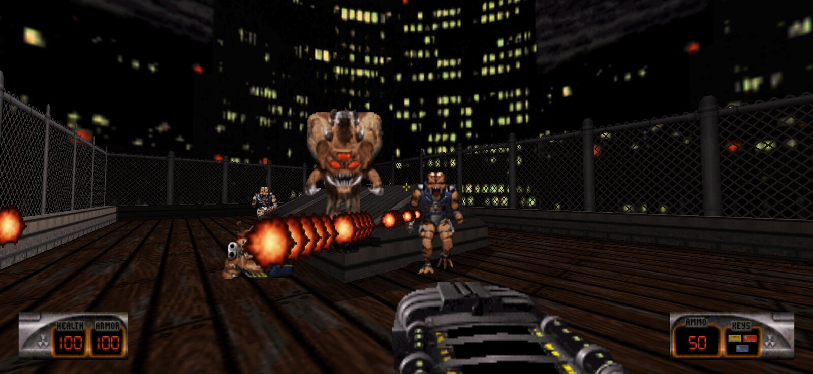
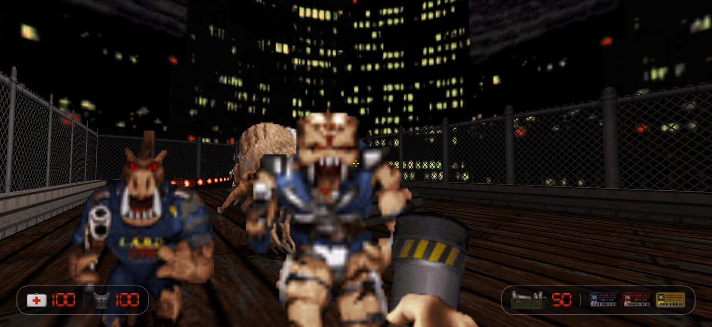
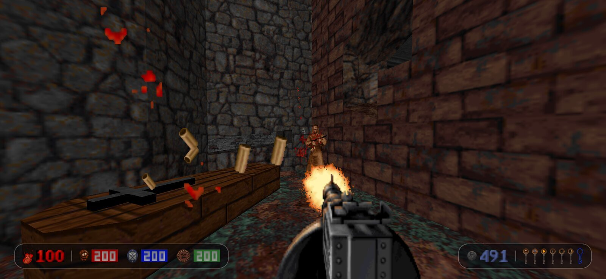
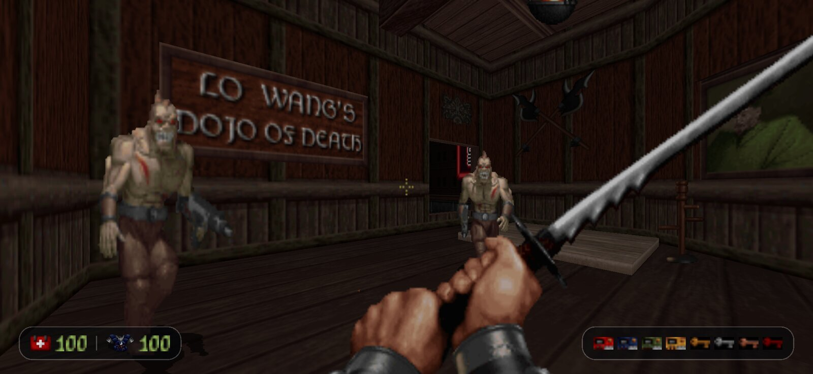
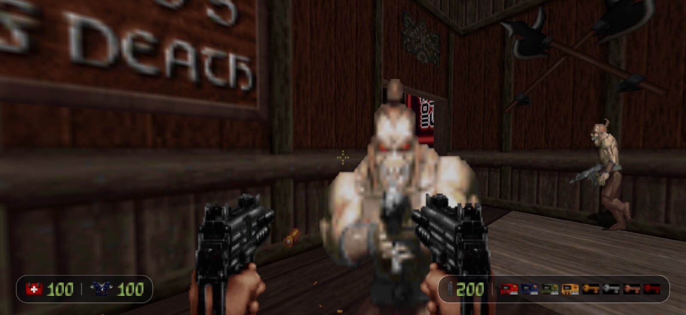
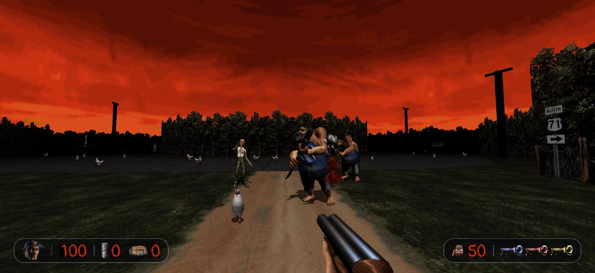
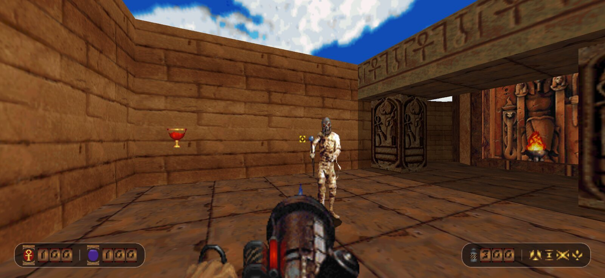

# Duke Nukem 3D, Blood, Shadow Warrior, Redneck Rampage and PowerSlave for iPhone and iPad (Raze)

Play the classic Build engine shooters on iPhone and iPad, with touch controls: **Duke Nukem 3D**, **Blood**, **Shadow Warrior**, **Redneck Rampage** and **PowerSlave** (*Exhumed*), with their add-ons. One app plays them all. It's an unofficial port of [Raze](https://github.com/ZDoom/Raze), the open-source port of these games.



**You need your own copies of the games. Game files are not included.** They're sold on Steam and GOG, for example *[Duke Nukem 3D: 20th Anniversary World Tour](https://store.steampowered.com/app/434050/)*, *[Blood: Fresh Supply](https://store.steampowered.com/app/1010750/)*, *[Shadow Warrior Classic Complete](https://www.gog.com/game/shadow_warrior_complete)*, the *[Redneck Rampage Collection](https://www.gog.com/game/redneck_rampage_collection)* and *[PowerSlave Exhumed](https://www.gog.com/game/powerslave_exhumed)*. Then copy their folders to your iPhone or iPad. (The editions this was made with are listed in the [guide](https://github.com/sithewok13-dev/Raze-iOS-/blob/ios/ios/RELEASE_NOTES.md#requirements).)

## Install

You need an iPhone or iPad with iOS 15 or newer. The app isn't on the App Store, so you install it yourself ("sideloading"). Pick one way:

- **SideStore or AltStore (easiest).** On your iPhone, open **[the install page](https://sithewok13-dev.github.io/raze/)** and tap *Add to SideStore* or *Add to AltStore*, then install **Raze** from there. Updates come the same way.
- **Feather, Sideloadly or another signing tool.** Download `Raze.ipa` from the [releases page](https://github.com/sithewok13-dev/Raze-iOS-/releases) and sign it with your tool.
- **The source by hand.** In SideStore, AltStore or Feather, go to *Sources*, tap **+**, and paste this address:

  ```
  https://raw.githubusercontent.com/sithewok13-dev/Raze-iOS-/ios/ios/altstore-source.json
  ```

Then open the app once (it says it found no game data: that's expected), and copy each game's folder into *Files > On My iPhone > Raze*. [Which files go where](https://github.com/sithewok13-dev/Raze-iOS-/blob/ios/ios/RELEASE_NOTES.md#install)

AltStore here means AltStore Classic; AltStore PAL can't install it. Until the first numbered release is out, the releases page and the source offer the newest test build, which may not have been tried yet.

## Cool features

- **Five games, one app.** A card for each game you copied in; hold a card for its add-ons (*Duke It Out in D.C.*, *Nuclear Winter*, *Cryptic Passage*, *Twin Dragon*, *Rides Again* and more).
- **Touch controls made for these games.** A stick under your left thumb, drag to look, FIRE with JUMP, USE and CROUCH round it, KICK in Duke and ALT FIRE in Blood.
- **Weapon wheel.** Slide from NEXT WPN or PREV WPN and pick a weapon by its own picture, with its ammo.
- **A button for every item you carry,** with the item's own picture: Duke's jetpack and HoloDuke, Blood's crystal ball, Lo Wang's smoke bombs. Duke's jetpack flies where you look.
- **Six HUD looks,** among them the game's own status bar split into the two bottom corners.
- **60 or 120 frames a second,** drawn with Vulkan on Metal. Sharp or smooth pixels, and smoother textures if you like.
- **CAMERA:** photos, bursts, selfies with the enemies posing, Action Freeze and a cinematic burst, straight to your Photos.
- **The cheat** (`sithewok`): god mode, every weapon, full ammo, walk through walls, fly in Shadow Warrior. **LEVEL** jumps to any level.
- **Tilt aiming,** quick save and quick load on a short hold, game controllers, and LAN multiplayer on Wi-Fi (see below).

## More

- **[Release notes and full guide](https://github.com/sithewok13-dev/Raze-iOS-/blob/ios/ios/RELEASE_NOTES.md):** installing, copying your game files, every control.
- **Sorry about the bugs.** It's an unofficial beta: expect bugs, and back up your saves. **Multiplayer especially:** LAN games have only been tried between copies of the game on one computer, never between two real iPhones, so they may not connect or may fall out of step. Sorry; it's being worked on. Found a bug? [Report it here](https://github.com/sithewok13-dev/Raze-iOS-/issues), not to upstream Raze.

<p>






</p>

*All the pictures come from the same game code running on a computer, with the real game files, so they show the HUD but not the touch buttons. A few enemies were placed with the game's console for the pictures.*

## Thanks

This port stands on the work of many people, and we're grateful to all of them:

- **[Raze](https://github.com/ZDoom/Raze)** by Christoph Oelckers and Mitchell Richters, with the [ZDoom and GZDoom](https://zdoom.org/) teams and contributors.
- **Ken Silverman**, for the [Build engine](http://www.advsys.net/ken).
- **3D Realms**, who released the Duke Nukem 3D and Shadow Warrior source code.
- **Jonathon Fowler** (JonoF) for JFDuke3D, and the **[EDuke32](https://eduke32.com/)** team: Richard Gobeille (TerminX), Evan Ramos (Hendricks266), pogokeen, Plagman and Helixhorned.
- **[NBlood](https://github.com/nukeykt/NBlood)** by Nuke.YKT, NoOne and sirlemonhead (Blood), and Nuke.YKT's reconstructed Redneck Rampage source.
- **VoidSW** and SWP (Shadow Warrior), **PCExhumed** by sirlemonhead, Nuke.YKT and NY00123 (PowerSlave), and BuildGDX by M210.
- The games' makers: 3D Realms, Monolith Productions, Xatrix Entertainment and Lobotomy Software.
- [SDL](https://www.libsdl.org/), [OpenAL Soft](https://openal-soft.org/), [ZMusic](https://github.com/ZDoom/ZMusic), [libvpx](https://github.com/webmproject/libvpx) and [MoltenVK](https://github.com/KhronosGroup/MoltenVK).

The full list of Raze's authors is in [AUTHORS.md](https://github.com/sithewok13-dev/Raze-iOS-/blob/ios/AUTHORS.md).

Not affiliated with or endorsed by the games' makers or rights holders, and not an official Raze release.

---

*The rest of this page is upstream Raze's README, by Christoph Oelckers and the Raze and ZDoom teams, from [ZDoom/Raze](https://github.com/ZDoom/Raze). Its links point to upstream; for the iOS port, see above.*

# Welcome to Raze!

[](https://github.com/ZDoom/Raze/actions/workflows/continuous_integration.yml)

## Raze is a fork of Build engine games backed by GZDoom tech and combines Duke Nukem 3D, Blood, Redneck Rampage, Shadow Warrior and Exhumed/Powerslave in a single package. It is also capable of playing Nam and WW2 GI.

The game modules are based on the following sources:

  * Duke Nukem: JFDuke, EDuke 2.0, World Tour extensions from DukeGDX and some minor fixes from EDuke32.
  * Redneck Rampage: Nuke.YKT's reconstructed source available in the Rednukem Git repo.
  * Blood: NBlood.
  * Shadow Warrior: SWP and VoidSW.
  * Exhumed/Powerslave: PCExhumed, with some enhancements inspired by PowerslaveGDX.

ZDoom, GZDoom Copyright (c) 1998-2022 ZDoom + GZDoom teams, and contributors

Doom Source (c) 1997 id Software, Raven Software, and contributors

EDuke32 and VoidSW Source (c) 2005-2020 EDuke32 teams, and contributors

NBlood source (c) 2019-2020 Nuke.YKT

PCExhumed source (c) 2019-2020 sirlemonhead, Nuke.YKT

BuildGDX (c) 2020

Duke Nukem 3D Source (c) 1996-2003 3D Realms

Shadow Warrior Source (c) 1997-2005 3D Realms

"Build Engine & Tools" Copyright (c) 1993-1997 Ken Silverman
Ken Silverman's official web site: http://www.advsys.net/ken
See the included license file "BUILDLIC.TXT" for license info.

Please see license files for individual contributor licenses

Special thanks to Coraline of the 3DGE team for allowing us to use her README.md as a template for this one.

### Non-Build code is licensed under the GPL v2
##### https://www.gnu.org/licenses/old-licenses/gpl-2.0.html
---

## How to build Raze

To build Raze, please see the [wiki](https://zdoom.org/wiki/) and see the "Programmer's Corner" on the bottom-right corner of the page to build for your platform - use this repository instead of GZDoom's.

### macOS dependencies

Use ZMusic 1.1.14, matching the CI builds. For builds using the vcpkg toolchain,
these options bundle the MoltenVK runtime and link OpenAL Soft for audio:

```sh
cmake -S . -B build \
  -DCMAKE_TOOLCHAIN_FILE=/path/to/vcpkg/scripts/buildsystems/vcpkg.cmake \
  -DMOLTENVK_VCPKG=ON -DOPENAL_SOFT_VCPKG=ON -DDYN_OPENAL=OFF
cmake --build build --parallel
```

The local vcpkg overlay downloads the official MoltenVK 1.4.2 macOS binary,
verifies its checksum, and bundles it and its license in `raze.app`. It supports
Apple Silicon and Intel Macs running macOS 12 or newer. Vulkan must remain
enabled (`HAVE_VULKAN=ON`, the default). The MoltenVK option is off by default;
builds without it can still use an externally installed Vulkan runtime.

# Resources
- https://raze.zdoom.org/ - Home Page
- https://forum.zdoom.org/viewforum.php?f=351 - Forum
- https://raze.zdoom.org/wiki/ - Wiki
- https://dsc.gg/zdoom - Discord Server
- https://docs.google.com/spreadsheets/d/1pvwXEgytkor9SClCiDn4j5AH7FedyXS-ocCbsuQIXDU/edit?usp=sharing - Translation sheet (Google Docs)
